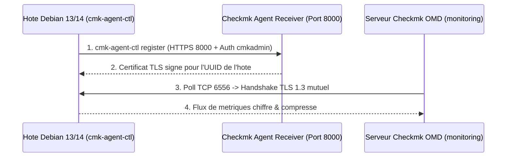

<!-- MASTER-HEADER-START -->
<div align="center">

<a href="https://0xcyberlitech.com/">
  
</a>

<p align="center">
  <a href="https://0xcyberlitech.com/"></a>
  <a href="https://0xcyberlitech.com/soc-rd.html"></a>
  <a href="https://0xcyberlitech.com/jarvis-rd.html"></a>
  <a href="https://github.com/0xCyberLiTech?tab=repositories"></a>
</p>
<p align="center">
  <a href="README.md"></a>
</p>


</div>
<!-- MASTER-HEADER-END -->

<!-- DEBIAN-TRUTH-START -->
> [!IMPORTANT]
>  ** Matrice Officielle Debian — `Debian 12 (Bookworm)` · `Debian 13 (Trixie)` · `Debian 14 (Forky)`**
> - **Sources Officielles Debian.org (`monitoring-plugins`) :** `Bookworm (12)` : **`2.3.3-5+deb12u2`** &nbsp;·&nbsp; `Trixie (13 — Stable)` : **`2.4.0-3+deb13u1`** &nbsp;·&nbsp; `Forky (14 — Next-Gen)` : **`2.4.0-5`**
> - **Références Officielles :** [Paquet Debian Trixie (`monitoring-plugins`)](https://packages.debian.org/trixie/monitoring-plugins) &nbsp;·&nbsp; [Paquet Debian Forky (`monitoring-plugins`)](https://packages.debian.org/forky/monitoring-plugins) &nbsp;·&nbsp; [Documentation Officielle Debian](https://packages.debian.org/trixie/monitoring-plugins)
> - **Note d'Ingénierie (Divergence 13 vs 14) :** Debian 13 (Trixie) et Debian 14 (Forky) utilisent désormais `sqv` (Sequoia OpenPGP en Rust) et `apt install ./paquet.deb` en remplacement de `dpkg -i` + `apt-get -f install`.

<details>
<summary> <b>Afficher les Encarts Ligne de Commande : Debian 13 (Trixie — Stable) vs Debian 14 (Forky — Next-Gen)</b></summary>

####  Profil Production Stable — Commandes pour `Debian 13 (Trixie)`
```bash
# Installation d'un paquet .deb Checkmk Raw sur Debian 13 (Trixie) avec resolution auto :
sudo apt update && sudo apt install -y ./check-mk-raw-*_trixie_amd64.deb
sudo omd status
```

####  Profil Anticipation Next-Gen — Commandes pour `Debian 14 (Forky)`
```bash
# Debian 14 (Forky) — Verification de la signature GPG via sqv (Sequoia PGP) & APT 3.0 :
sudo apt install --solver 3.0 -y ./check-mk-raw-*.deb
journalctl -u omd -f --no-hostname
```

</details>
<!-- DEBIAN-TRUTH-END -->

<!-- CIEL-PEDAGOGY-START -->
<details>
<summary> <b>Synthèse d'Architecture, Standards Officiels &amp; Diagnostic (Niveau 1 : Fondamentaux · Niveau 2 : Repères · Niveau 3 : Diagnostic)</b></summary>

- **Niveau 1 — Fondamentaux &amp; Principe d'Architecture :** **Checkmk Raw Edition (OMD)** est une suite de supervision haute performance qui interroge l'ensemble des composants d'un serveur (processus, systèmes de fichiers, interfaces, matériel) en une unique transaction TCP et automatise la découverte des services.
- **Niveau 2 — Repères Officiels (Ports IANA, Fichiers Debian &amp; Commandes de Validation) :** **Ports :** `TCP 6556` (Checkmk Agent) · `TCP 8000` (Agent Receiver TLS) · `TCP 5000` (Serveur applicatif OMD interne) &nbsp;|&nbsp; **Commandes officielles :** `sudo omd status`, `sudo omd su <site>`, `cmk -v <hote>`.
- **Niveau 3 — Diagnostic d'Incidents &amp; Ingénierie Avancée :** **Diagnostic & Architecture :** L'architecture **OMD (*Open Monitoring Distribution*)** isole chaque instance dans son propre espace utilisateur (`/omd/sites/<site>`), permettant de faire cohabiter et de mettre à jour plusieurs environnements indépendants sur un même serveur Debian. Le chiffrement TLS de l'agent s'active via `cmk-agent-ctl register`.
- **Sources de Vérité Officielles Éditeurs &amp; Standards :** [Documentation Officielle Checkmk](https://docs.checkmk.com/latest/en/) &nbsp;·&nbsp; [Téléchargements Officiels Checkmk Debian](https://checkmk.com/download)
- **Livres Blancs &amp; 67 Podcasts Audio R&amp;D :** [Portail 0xCyberLiTech](https://0xcyberlitech.com/) &nbsp;·&nbsp; [Livre Blanc SOC Cockpit v5.5](https://0xcyberlitech.com/soc-rd.html) &nbsp;·&nbsp; [Livre Blanc JARVIS Mark-VII](https://0xcyberlitech.com/jarvis-rd.html) &nbsp;·&nbsp; [Blueprint Logiciel &amp; Matériel RTX 5080](https://0xcyberlitech.com/blueprint-jarvis.html)

</details>
<!-- CIEL-PEDAGOGY-END -->


#  CHECKMK RAW EDITION (OMD) — Configuration, Enregistrement TLS des Agents & Tableaux de Bord (Debian 12, 13 & 14)

> **Objectif Opérationnel :** Configurer en profondeur une instance **Checkmk Raw Edition (2.3 / 2.4)** sous **Debian 12 (Bookworm)**, **Debian 13 (Trixie — Stable)** et **Debian 14 (Forky — Next-Gen)** : enrôlement chiffré TLS des agents (`cmk-agent-ctl`), découverte automatique des services, règles de seuils d'alerte, notifications et création d'un **Dashboard SOC/NOC personnalisé**.

---

##  01 // Architecture du Flux Agent TLS (`cmk-agent-ctl`)


Depuis Checkmk 2.1+ et généralisé en **2.3 / 2.4**, la collecte sur le port TCP `6556` est intégralement chiffrée en **TLS 1.3** avec authentification mutuelle par certificat signé par l'autorité interne du site OMD.



---

##  02 // Ajout d'un Hôte et Enregistrement TLS (`cmk-agent-ctl`)


###  Déclaration de l'hôte dans Checkmk

1. Dans l'interface Web Checkmk, ouvrez **Setup > Hosts > Add host**.
2. Renseignez :
   - **Hostname** : `srv-debian13-prod`
   - **IPv4 Address** : `192.168.1.50`
3. Cliquez sur **Save & run service discovery**, puis activez les changements (**Activate on selected sites**).

###  Enregistrement TLS depuis le serveur Debian supervisé

Sur la machine cliente Debian 12, 13 ou 14, exécutez `cmk-agent-ctl register` pour sceller le canal TLS avec le serveur Checkmk :

<!-- CODE-WINDOW-START -->
> [!CAUTION]
> 
>
> ```bash
> sudo cmk-agent-ctl register \
>   --hostname srv-debian13-prod \
>   --server 192.168.1.100 \
>   --site monitoring \
>   --user cmkadmin
> ```
<!-- CODE-WINDOW-END -->

Vérifiez l'état du canal TLS :

<!-- CODE-WINDOW-START -->
> [!CAUTION]
> 
>
> ```bash
> sudo cmk-agent-ctl status
> ```
<!-- CODE-WINDOW-END -->

Sortie attendue :

<!-- CODE-WINDOW-START -->
> [!CAUTION]
> 
>
> ```bash
> Version: 2.3.0p26
> Agent socket: operational
> IP allowlist: any
> Connection: 192.168.1.100/monitoring
>     UUID: 9f8c2a1b-4e7d-4c3a-9b12-8a7e6f5d4c3b
>     Local:
>         Connection mode: pull-agent
>         Connecting to receiver: operational
>         Certificate issuer: Site 'monitoring' agent signing CA
>         Certificate validity:valid
> ```
<!-- CODE-WINDOW-END -->

---

##  03 // Découverte Automatique et Gestion en Ligne de Commande (`cmk`)


Vous pouvez piloter la découverte des services et recharger le moteur directement en CLI depuis le site OMD :

<!-- CODE-WINDOW-START -->
> [!CAUTION]
> 
>
> ```bash
> # Passer sous l'utilisateur du site OMD
> sudo su - monitoring
>
> # Scanner les nouveaux services de l'hote
> cmk -I srv-debian13-prod
>
> # Compiler et recharger la configuration active sans coupure
> cmk -O
>
> # Tester en direct la collecte d'un hote
> cmk -d srv-debian13-prod | head -n 40
> ```
<!-- CODE-WINDOW-END -->

---

##  04 // Supervision Avancée : Plugins Linux (Docker, SMART, Systemd, APT)


Sur les hôtes **Debian 12, 13 (Trixie) et 14 (Forky)**, activez les plugins officiels situés dans `/usr/share/check-mk-agent/available-plugins/` en les liant dans `/usr/lib/check_mk_agent/plugins/` :

<!-- CODE-WINDOW-START -->
> [!CAUTION]
> 
>
> ```bash
> sudo mkdir -p /usr/lib/check_mk_agent/plugins/3600
>
> # Verification asynchrone des mises a jour APT toutes les heures (3600s) :
> sudo ln -sf /usr/share/check-mk-agent/available-plugins/mk_apt /usr/lib/check_mk_agent/plugins/3600/mk_apt
>
> # Supervision des disques NVMe / SMART :
> sudo apt install -y smartmontools
> sudo ln -sf /usr/share/check-mk-agent/available-plugins/smart /usr/lib/check_mk_agent/plugins/smart
> ```
<!-- CODE-WINDOW-END -->

Relancez une découverte sur le serveur Checkmk :

<!-- CODE-WINDOW-START -->
> [!CAUTION]
> 
>
> ```bash
> sudo su - monitoring -c "cmk -II srv-debian13-prod && cmk -O"
> ```
<!-- CODE-WINDOW-END -->

---

<a name="dashboards"></a>
##  05 // Création et Personnalisation d'un Tableau de Bord (Dashboard NOC/SOC)


Pour créer un tableau de bord dédié à vos serveurs critiques sous Checkmk :

1. Ouvrez **Customize > Visualization > Dashboards**.
2. Cliquez sur **Add dashboard** :
   - **Unique ID** : `noc_debian_infra`
   - **Title** : `Supervision Infrastructure Debian 12 / 13 / 14`
3. Dans l'éditeur du Dashboard, cliquez sur **Add > Views / Graphs / Metrics** :
   - **Host statistics** & **Service statistics** (hexagones d'état global),
   - **Top 10 : CPU utilization** et **Top 10 : Memory utilization**,
   - **Problemビュー (Unhandled host & service problems)** filtré sur l'état `WARN` / `CRIT`,
   - **Combined graph** pour la bande passante réseau des interfaces principales.

---

##  06 // Sauvegarde et Mise à Jour d'un Site OMD (`omd backup` & `omd update`)


###  Sauvegarde à chaud de l'instance OMD

<!-- CODE-WINDOW-START -->
> [!CAUTION]
> 
>
> ```bash
> sudo omd backup monitoring /var/backups/checkmk-monitoring-$(date +%F).tar.gz
> ```
<!-- CODE-WINDOW-END -->

###  Mise à jour vers une nouvelle version de Checkmk Raw

<!-- CODE-WINDOW-START -->
> [!CAUTION]
> 
>
> ```bash
> # 1. Installer le nouveau paquet .deb Checkmk Raw (qui cohabite dans /opt/omd/versions/)
> sudo apt install -y ./check-mk-raw-2.4.0_0.trixie_amd64.deb
>
> # 2. Arreter le site, migrer sa version et le redemarrer
> sudo omd stop monitoring
> sudo omd update monitoring
> sudo omd start monitoring
> ```
<!-- CODE-WINDOW-END -->

<!-- MASTER-FOOTER-START -->
<div align="center">


<a href="https://0xcyberlitech.com/">
  
</a>

<p align="center"><a href="https://0xcyberlitech.com/"></a></p>

<sub><b>Architecturé &amp; Forgé par Marc &amp; Antigravity (Google DeepMind)</b> &nbsp;·&nbsp; <a href="https://0xcyberlitech.com/"><b>0xcyberlitech.com</b></a> &nbsp;·&nbsp; <a href="https://0xcyberlitech.com/soc-rd.html">Architecture SOC Cockpit v5.5</a> &nbsp;·&nbsp; <a href="https://0xcyberlitech.com/jarvis-rd.html">Architecture JARVIS Mark-VII</a> &nbsp;·&nbsp; <a href="https://0xcyberlitech.com/blueprint-jarvis.html">Blueprint Matériel RTX 5080</a></sub>

</div>
<!-- MASTER-FOOTER-END -->
