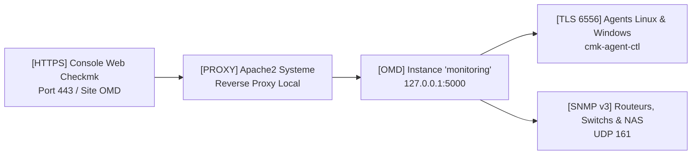

<!-- MASTER-HEADER-START -->
<div align="center">

<a href="https://0xcyberlitech.com/">
  
</a>

<p align="center">
  <a href="https://0xcyberlitech.com/"></a>
  <a href="https://0xcyberlitech.com/soc-rd.html"></a>
  <a href="https://0xcyberlitech.com/jarvis-rd.html"></a>
  <a href="https://github.com/0xCyberLiTech?tab=repositories"></a>
</p>
<p align="center">
  <a href="README.md"></a>
</p>


</div>
<!-- MASTER-HEADER-END -->

<!-- DEBIAN-TRUTH-START -->
> [!IMPORTANT]
>  ** Matrice Officielle Debian — `Debian 12 (Bookworm)` · `Debian 13 (Trixie)` · `Debian 14 (Forky)`**
> - **Sources Officielles Debian.org (`monitoring-plugins`) :** `Bookworm (12)` : **`2.3.3-5+deb12u2`** &nbsp;·&nbsp; `Trixie (13 — Stable)` : **`2.4.0-3+deb13u1`** &nbsp;·&nbsp; `Forky (14 — Next-Gen)` : **`2.4.0-5`**
> - **Références Officielles :** [Paquet Debian Trixie (`monitoring-plugins`)](https://packages.debian.org/trixie/monitoring-plugins) &nbsp;·&nbsp; [Paquet Debian Forky (`monitoring-plugins`)](https://packages.debian.org/forky/monitoring-plugins) &nbsp;·&nbsp; [Documentation Officielle Debian](https://packages.debian.org/trixie/monitoring-plugins)
> - **Note d'Ingénierie (Divergence 13 vs 14) :** Debian 13 (Trixie) et Debian 14 (Forky) utilisent désormais `sqv` (Sequoia OpenPGP en Rust) et `apt install ./paquet.deb` en remplacement de `dpkg -i` + `apt-get -f install`.

<details>
<summary> <b>Afficher les Encarts Ligne de Commande : Debian 13 (Trixie — Stable) vs Debian 14 (Forky — Next-Gen)</b></summary>

####  Profil Production Stable — Commandes pour `Debian 13 (Trixie)`
```bash
# Installation d'un paquet .deb Checkmk Raw sur Debian 13 (Trixie) avec resolution auto :
sudo apt update && sudo apt install -y ./check-mk-raw-*_trixie_amd64.deb
sudo omd status
```

####  Profil Anticipation Next-Gen — Commandes pour `Debian 14 (Forky)`
```bash
# Debian 14 (Forky) — Verification de la signature GPG via sqv (Sequoia PGP) & APT 3.0 :
sudo apt install --solver 3.0 -y ./check-mk-raw-*.deb
journalctl -u omd -f --no-hostname
```

</details>
<!-- DEBIAN-TRUTH-END -->

<!-- CIEL-PEDAGOGY-START -->
<details>
<summary> <b>Synthèse d'Architecture, Standards Officiels &amp; Diagnostic (Niveau 1 : Fondamentaux · Niveau 2 : Repères · Niveau 3 : Diagnostic)</b></summary>

- **Niveau 1 — Fondamentaux &amp; Principe d'Architecture :** **Checkmk Raw Edition (OMD)** est une suite de supervision haute performance qui interroge l'ensemble des composants d'un serveur (processus, systèmes de fichiers, interfaces, matériel) en une unique transaction TCP et automatise la découverte des services.
- **Niveau 2 — Repères Officiels (Ports IANA, Fichiers Debian &amp; Commandes de Validation) :** **Ports :** `TCP 6556` (Checkmk Agent) · `TCP 8000` (Agent Receiver TLS) · `TCP 5000` (Serveur applicatif OMD interne) &nbsp;|&nbsp; **Commandes officielles :** `sudo omd status`, `sudo omd su <site>`, `cmk -v <hote>`.
- **Niveau 3 — Diagnostic d'Incidents &amp; Ingénierie Avancée :** **Diagnostic & Architecture :** L'architecture **OMD (*Open Monitoring Distribution*)** isole chaque instance dans son propre espace utilisateur (`/omd/sites/<site>`), permettant de faire cohabiter et de mettre à jour plusieurs environnements indépendants sur un même serveur Debian. Le chiffrement TLS de l'agent s'active via `cmk-agent-ctl register`.
- **Sources de Vérité Officielles Éditeurs &amp; Standards :** [Documentation Officielle Checkmk](https://docs.checkmk.com/latest/en/) &nbsp;·&nbsp; [Téléchargements Officiels Checkmk Debian](https://checkmk.com/download)

</details>
<!-- CIEL-PEDAGOGY-END -->


#  CHECKMK RAW EDITION (OMD) — Installation Complète sur Debian 12 (Bookworm), Debian 13 (Trixie) & Debian 14 (Forky)

> **Objectif Opérationnel :** Déployer un serveur de supervision **Checkmk Raw Edition (2.3 / 2.4 Stable)** basé sur **OMD (Open Monitoring Distribution)** sous **Debian 12 (Bookworm)**, **Debian 13 (Trixie — Stable)** et **Debian 14 (Forky — Next-Gen)**, créer une instance de monitoring isolée, sécuriser l'accès HTTPS et superviser le premier hôte Linux via `check-mk-agent`.

---

##  01 // Architecture & Prérequis Système


Checkmk Raw Edition embarque dans un paquet `.deb` autonome l'ensemble de sa pile d'exécution via **OMD** (`Monitoring Core`, `Apache2 Proxy`, `RRDtool / PNP4Nagios`, `Python 3`, `Checkmk Web UI`).

| Composant | Debian 12 (`Bookworm`) | Debian 13 (`Trixie` — Stable) | Debian 14 (`Forky` — Next-Gen) |
|:---|:---|:---|:---|
| **Édition Checkmk** | Checkmk Raw `2.3.0pX` / `2.4.0` | Checkmk Raw `2.3.0pX` / `2.4.0` | Checkmk Raw `2.4.0+` |
| **Vérification GPG** | `gpg` / `dpkg-sig` | `sqv` (Sequoia OpenPGP Rust) | `sqv` & solveur `APT 3.0` |
| **Installation `.deb`** | `apt install ./check-mk-raw-*.deb` | `apt install ./check-mk-raw-*.deb` | `apt install ./check-mk-raw-*.deb` |
| **Ressources Minimales** | 2 vCPU · 4 Go RAM · 40 Go NVMe | 4 vCPU · 8 Go RAM · 60 Go NVMe | 4 vCPU · 8 Go RAM · 60 Go NVMe |



---

##  02 // Préparation du Serveur Debian (12 / 13 / 14)


Mettez à jour le système et configurez le fuseau horaire ainsi que la synchronisation NTP :

<!-- CODE-WINDOW-START -->
> [!CAUTION]
> 
>
> ```bash
> sudo apt update && sudo apt full-upgrade -y
> sudo apt install -y curl wget ca-certificates gnupg lsb-release chrony
> sudo timedatectl set-timezone Europe/Paris
> ```
<!-- CODE-WINDOW-END -->

---

##  03 // Téléchargement et Vérification du Paquet Officiel Checkmk Raw


Récupérez automatiquement le nom de code de votre distribution Debian (`bookworm` ou `trixie`) et téléchargez le paquet officiel **Checkmk Raw Edition** :

<!-- CODE-WINDOW-START -->
> [!CAUTION]
> 
>
> ```bash
> mkdir -p /usr/local/src/checkmk
> cd /usr/local/src/checkmk
>
> CODENAME=$(. /etc/os-release && echo "${VERSION_CODENAME:-trixie}")
> # Sous Debian 14 (forky), on utilise le paquet trixie tant que le depot forky dedie n'est pas separe
> [ "$CODENAME" = "forky" ] && CODENAME="trixie"
>
> CMK_VER="2.4.0p22"
> wget "https://download.checkmk.com/checkmk/${CMK_VER}/check-mk-raw-${CMK_VER}_0.${CODENAME}_amd64.deb"
> ```
<!-- CODE-WINDOW-END -->

Vérifiez l'intégrité cryptographique et installez le paquet avec résolution automatique des dépendances via `apt install ./fichier.deb` (méthode recommandée sous Debian 12, 13 et 14 en remplacement de `dpkg -i`) :

<!-- CODE-WINDOW-START -->
> [!CAUTION]
> 
>
> ```bash
> sudo apt install -y "./check-mk-raw-${CMK_VER}_0.${CODENAME}_amd64.deb"
> ```
<!-- CODE-WINDOW-END -->

Vérifiez que la commande `omd` est opérationnelle :

<!-- CODE-WINDOW-START -->
> [!CAUTION]
> 
>
> ```bash
> omd version
> ```
<!-- CODE-WINDOW-END -->

---

##  04 // Création et Démarrage de l'Instance OMD (`monitoring`)


Créez votre site de supervision nommé `monitoring` via `omd create` :

<!-- CODE-WINDOW-START -->
> [!CAUTION]
> 
>
> ```bash
> sudo omd create monitoring
> ```
<!-- CODE-WINDOW-END -->

> **Note importante :** Lors de la création du site, OMD affiche le mot de passe initial généré pour le compte administrateur **`cmkadmin`**. Vous pouvez également définir ou réinitialiser ce mot de passe à tout moment :

<!-- CODE-WINDOW-START -->
> [!CAUTION]
> 
>
> ```bash
> sudo su - monitoring -c "cmk-passwd cmkadmin"
> ```
<!-- CODE-WINDOW-END -->

Démarrez l'instance OMD et vérifiez l'état de tous ses démons internes (`mkeventd`, `rrdcached`, `npcd`, `nagios`, `apache`, `redis`, `crontab`) :

<!-- CODE-WINDOW-START -->
> [!CAUTION]
> 
>
> ```bash
> sudo omd start monitoring
> sudo omd status monitoring
> ```
<!-- CODE-WINDOW-END -->

---

##  05 // Sécurisation Pare-feu (UFW / Nftables) et Accès Web


Autorisez les flux HTTP/HTTPS pour l'interface Web ainsi que le port TCP `6556` pour la communication TLS avec les agents Checkmk :

<!-- CODE-WINDOW-START -->
> [!CAUTION]
> 
>
> ```bash
> sudo ufw allow 80/tcp comment 'Checkmk HTTP Redirect'
> sudo ufw allow 443/tcp comment 'Checkmk Web UI HTTPS'
> sudo ufw allow 6556/tcp comment 'Checkmk Agent TLS'
> sudo ufw reload
> ```
<!-- CODE-WINDOW-END -->

L'interface Web est immédiatement accessible sur :
- `http://<IP_SERVEUR>/monitoring/`
- Identifiant : **`cmkadmin`**

---

##  06 // Déploiement de l'Agent Checkmk sur un Hôte Debian (12 / 13 / 14)


Récupérez le paquet `.deb` de l'agent directement depuis votre serveur Checkmk et installez-le sur la machine cible à superviser :

<!-- CODE-WINDOW-START -->
> [!CAUTION]
> 
>
> ```bash
> wget "http://<IP_SERVEUR>/monitoring/check_mk/agents/check-mk-agent_2.4.0p22-1_all.deb"
> sudo apt install -y ./check-mk-agent_2.4.0p22-1_all.deb
> ```
<!-- CODE-WINDOW-END -->

Vérifiez que le socket `check-mk-agent.socket` (systemd natif sur Debian 12, 13 & 14) et le contrôleur `cmk-agent-ctl` sont actifs :

<!-- CODE-WINDOW-START -->
> [!CAUTION]
> 
>
> ```bash
> sudo systemctl status check-mk-agent.socket
> sudo cmk-agent-ctl status
> ```
<!-- CODE-WINDOW-END -->

<!-- MASTER-FOOTER-START -->
<div align="center">


<a href="https://0xcyberlitech.com/">
  
</a>

<p align="center"><a href="https://0xcyberlitech.com/"></a></p>

<sub><b>Architecturé &amp; Forgé par Marc &amp; Antigravity (Google DeepMind)</b> &nbsp;·&nbsp; <a href="https://0xcyberlitech.com/"><b>0xcyberlitech.com</b></a> &nbsp;·&nbsp; <a href="https://0xcyberlitech.com/soc-rd.html">Architecture SOC Cockpit v5.5</a> &nbsp;·&nbsp; <a href="https://0xcyberlitech.com/jarvis-rd.html">Architecture JARVIS Mark-VII</a> &nbsp;·&nbsp; <a href="https://0xcyberlitech.com/blueprint-jarvis.html">Blueprint Matériel RTX 5080</a></sub>

</div>
<!-- MASTER-FOOTER-END -->
